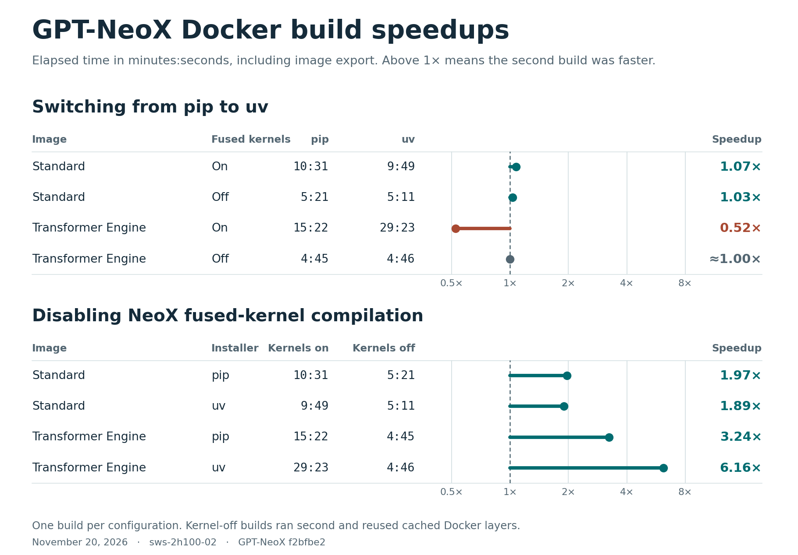

# GPT-NeoX container build results

The November 20 run on `sws-2h100-02` built all eight non-B200 Docker configurations. Both the standard and Transformer Engine images built with pip and uv, with fused kernels enabled and disabled. All four Apptainer commands exited with code 127 because the host could not find `apptainer`. [Per-case results](run-20261120T170239Z-7XVqsB/summary.tsv)

The report contains the 12 default-attention cases from the original run at GPT-NeoX revision `f2bfbe2`. The uv recipes in the saved build context were updated after that run. [Combined log](run-20261120T170239Z-7XVqsB/build.log)



To run the matrix from this repository, point the runner at a local GPT-NeoX checkout containing the container recipes. Each invocation writes its logs to a new run directory.

```bash
NEOX_CHECKOUT=/path/to/gpt-neox ./build-all.sh --tmux
```
