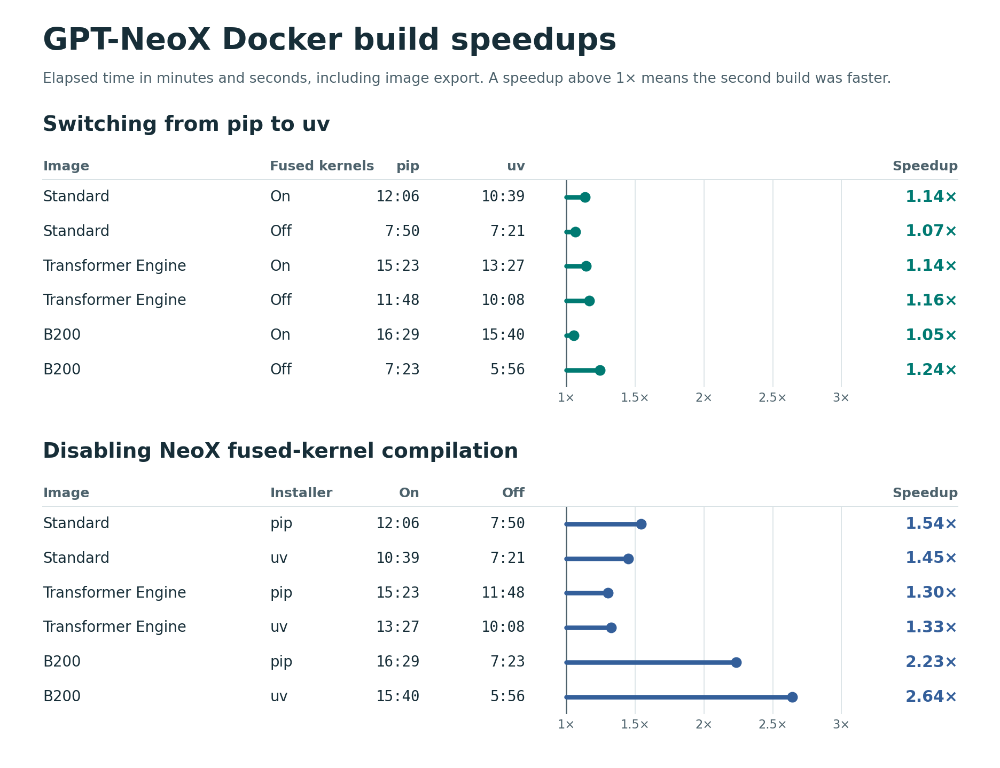

# Add uv container recipes and make GPT-NeoX fused-kernel builds optional

## Summary

- Add uv recipes for the standard, Transformer Engine, and B200 Docker images and for native Apptainer builds.
- Allow both B200 recipes to create `mchorse` when the base image already uses UID 1000. They keep UID 1000 when it is free.
- Add `--build-arg BUILD_FUSED_KERNELS=false` to the pip and uv recipes. The default still compiles the GPT-NeoX extensions. Both Transformer Engine recipes install `flash-attn==2.5.6` and allow its setup script to use an upstream wheel.
- Group related Docker setup steps, standardize the OCI image labels, and update the Docker, Compose, and Apptainer instructions to run from the repository root.

## Build results

All 12 Docker configurations built successfully across two runs on `sws-2h100-02`. The November 20, 2026 run measured the standard and Transformer Engine images at `f8c01c4`. The November 21 B200 rerun used `88c7227` after the UID fix. Both revisions predate the dependency updates on the rebased branch. [November 20 summary](https://github.com/aflah02/Container-Improvements-NeoX/blob/bfcf568f818cf51143676c05936e0f22f8980e04/run-20261120T211324Z-UafkfP/summary.tsv) · [B200 rerun summary](https://github.com/aflah02/Container-Improvements-NeoX/blob/bfcf568f818cf51143676c05936e0f22f8980e04/run-20261121T082946Z-7K25n5/summary.tsv)

Times are wall-clock minutes and seconds for one `docker build --pull --no-cache` per configuration, including image export. The speedup is pip time divided by uv time. The host lacked `apptainer`, so the native Apptainer cases have no build timings.

| Docker image | NeoX fused kernels | pip | uv | pip time / uv time |
| --- | --- | ---: | ---: | ---: |
| Standard | On | 12:06 | 10:39 | 1.14× |
| Standard | Off | 7:50 | 7:21 | 1.07× |
| Transformer Engine | On | 15:23 | 13:27 | 1.14× |
| Transformer Engine | Off | 11:48 | 10:08 | 1.16× |
| B200 | On | 16:29 | 15:40 | 1.05× |
| B200 | Off | 7:23 | 5:56 | 1.24× |

Disabling fused-kernel compilation saved 9m06s with pip and 9m44s with uv on the B200 recipe. With kernels enabled, the Transformer Engine uv build spent about 10 seconds preparing the FlashAttention wheel.

The matrix measured image creation. Runtime imports and GPU training were untested. The standard pip build at `f8c01c4` reported conflicts between `protobuf==3.20.3` and the installed W&B, OpenTelemetry, and cuDF packages.

